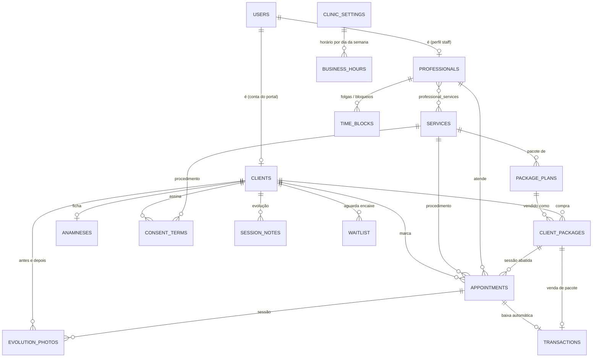

# 1. Modelagem do banco de dados

Modelo relacional pensado para PostgreSQL (Supabase). O protótipo guarda as mesmas tabelas no
`localStorage`, com os mesmos nomes de campos em *camelCase* (`clientId` ↔ `client_id`), então a troca
para o banco real é feita só na camada `src/data/` (ver [03-escalabilidade.md](03-escalabilidade.md)).
O SQL completo está em [`supabase/schema.sql`](../supabase/schema.sql).

## Diagrama de relacionamentos

## Tabelas

### Acesso e equipe
| Tabela | Campos principais | Observações |
|---|---|---|
| `users` | id, role (`admin` \| `professional` \| `client`), email, phone, created_at | No Supabase é a `auth.users`; senha nunca fica em tabela própria. |
| `professionals` | id, user_id → users, name, color, bio, active | Cor usada na agenda. |
| `professional_services` | professional_id, service_id (PK composta) | Quem faz qual procedimento. |
| `time_blocks` | id, professional_id, date, start, end, reason | Folga, curso, almoço fora do padrão. Entram no cálculo de horários livres. |

### Configuração da clínica
| Tabela | Campos principais | Observações |
|---|---|---|
| `clinic_settings` | id, name, whatsapp, slot_step_min, buffer_min, min_cancel_hours, min_advance_min, booking_window_days | Uma linha por clínica (multi-clínica no futuro: `clinic_id` em todas as tabelas). |
| `business_hours` | weekday (0–6), open, close, break_start, break_end, closed | Horário de funcionamento por dia da semana. |

### Catálogo
| Tabela | Campos principais | Observações |
|---|---|---|
| `services` | id, name, category, description, price, duration_min, requires_consent, active | `requires_consent` = procedimento invasivo, exige termo antes. |
| `package_plans` | id, service_id, name, sessions, price, validity_days, active | Modelo de pacote à venda (ex.: 10× drenagem). |

### Clientes e prontuário
| Tabela | Campos principais | Observações |
|---|---|---|
| `clients` | id, user_id → users (nulo se cadastrado pela clínica), name, whatsapp, email, birth_date, notes, created_at | Cliente pode existir sem conta no portal. |
| `anamneses` | id, client_id (único), health jsonb, allergies, medications, habits jsonb, facial_eval jsonb, body_eval jsonb, updated_at, updated_by | Campos estruturados em `jsonb` para o formulário evoluir sem migrations. |
| `session_notes` | id, client_id, appointment_id, service_id, date, protocol, text, reactions | Registro de evolução de cada sessão. |
| `evolution_photos` | id, client_id, appointment_id, taken_at, kind (`antes` \| `depois`), area, storage_path, notes | No Supabase a imagem vai para o Storage; a tabela guarda o caminho. |
| `consent_terms` | id, client_id, service_id, appointment_id, term_text, signature (imagem), accepted_at, accepted_via (`portal` \| `clinica`) | Guarda o texto exatamente como foi aceito (cópia), para valor jurídico. |

### Operação
| Tabela | Campos principais | Observações |
|---|---|---|
| `appointments` | id, client_id, professional_id, service_id, date, start, end, status, source (`online` \| `interno`), price, client_package_id, payment_method, notes, created_at, cancelled_at | `status`: `agendado`, `confirmado`, `em_atendimento`, `concluido`, `faltou`, `cancelado`. Índice em (professional_id, date). |
| `client_packages` | id, client_id, package_plan_id, service_id, total_sessions, used_sessions, price_paid, payment_method, sold_at, expires_at | Saldo = total − usadas. `used_sessions` sobe ao concluir atendimento pago com pacote. |
| `waitlist` | id, client_id (opcional), name, whatsapp, service_id, preferred_period, notes, created_at | Cadastro rápido de interessados em encaixe. |

### Financeiro
| Tabela | Campos principais | Observações |
|---|---|---|
| `transactions` | id, type (`entrada` \| `saida`), category, description, amount, method, status (`pago` \| `pendente`), due_date, paid_at, appointment_id, client_package_id, professional_id | Uma tabela só para caixa, contas a pagar e contas pagas. Despesa pendente = conta a pagar. |

## Regras de negócio que o modelo garante
1. **Baixa automática:** ao mudar um agendamento para `concluido`, o sistema pergunta a forma de pagamento.
   - Pix, Crédito, Débito ou Dinheiro: cria uma `transactions` de entrada, já paga, ligada ao `appointment_id`.
   - Abater de Pacote: incrementa `client_packages.used_sessions` e grava `client_package_id` no agendamento.
     Não entra dinheiro no caixa, porque o valor já entrou quando o pacote foi vendido.
2. **Receita por procedimento** (indicador "mais lucrativos"): soma os pagamentos avulsos mais a parte
   proporcional das sessões de pacote (`price_paid / total_sessions` por sessão usada).
3. **Cancelamento/reagendamento pelo cliente** só com `min_cancel_hours` de antecedência (padrão 24 h).
4. **Termo de consentimento**: procedimentos com `requires_consent` pedem o aceite no portal antes de
   confirmar, e a agenda avisa se o atendimento for concluído sem termo.
5. **Conflito de horário**: o cálculo de horários livres nunca oferece um horário ocupado. No banco real, uma
   *exclusion constraint* (`tsrange` + `btree_gist`) impede dois agendamentos ativos sobrepostos para o mesmo profissional.
